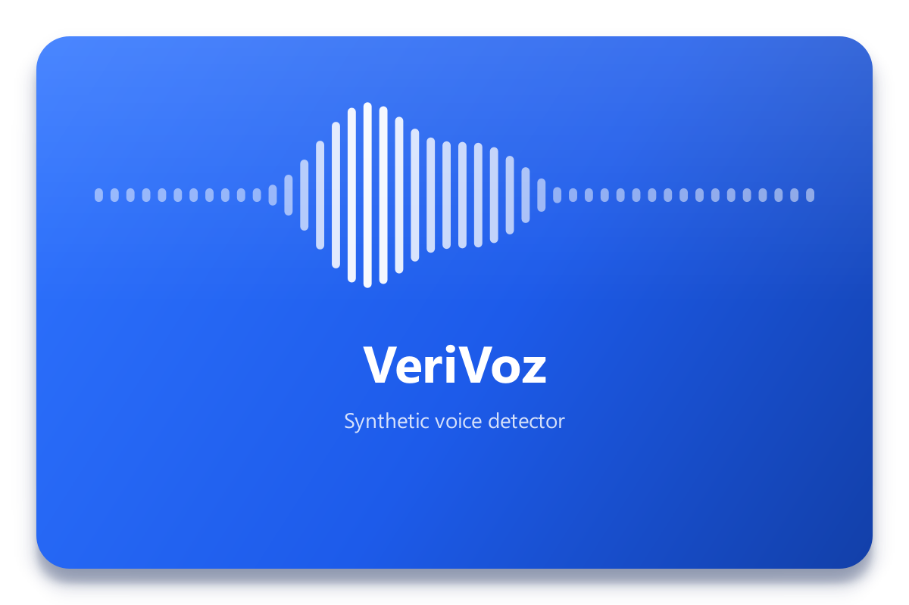

# VeriVoz — synthetic voice detector
<p align="center">
  
</p>
Desktop app (Python + PySide6) that analyzes audio with several anti-spoofing models to tell whether a voice is real or was generated/manipulated with AI. Multi-engine style: each model gives its verdict and they are combined into a total score.

## Installation (Windows 10/11)

**Requirements:** Python 3.10–3.13 ([python.org](https://www.python.org/downloads/), tick *Add python.exe to PATH*) · about **12 GB** free · an NVIDIA GPU is recommended (without one it runs on the CPU, slower).

1. Get the project: **Code › Download ZIP** (and unzip it) or
   `git clone https://github.com/nicolas-aguilar-f/VeriVoz.git`
2. Double-click **`install.bat`**. Before changing anything it shows what it will install, from where and how big it is, and asks for confirmation:

   | What | Source | Approx. size | License |
   |---|---|---|---|
   | `.venv` virtual environment (this folder only) | — | — | — |
   | PyTorch 2.11 (CUDA 12.8/12.6 with an NVIDIA GPU, otherwise CPU) | download.pytorch.org | 3 GB (CPU: 0.25 GB) | BSD |
   | Dependencies (`requirements.txt`) | pypi.org | 0.6 GB | various (open source) |
   | DF-Arena **1B** *or* **500M** (you choose) | [huggingface.co/Speech-Arena-2025](https://huggingface.co/Speech-Arena-2025) | 4.6 GB / 1.7 GB | **Non-commercial** (you are asked to accept it) |
   | XLS-R 300M and XLS-R configurations (Meta) | huggingface.co/facebook | 1.3 GB | Apache-2.0 |
   | XLSR-MLP classifier | [github.com/nicolas-aguilar-f/XLSR-MLP](https://github.com/nicolas-aguilar-f/XLSR-MLP) | 2 MB | see repository |

3. Double-click **`run.bat`**.

### Approximate specs of each model

| Model | Parameters | VRAM | RAM | Download |
|---|---|---|---|---|
| DF-Arena 1B | ≈ 1,150 M | 6 GB | 16 GB | 4.6 GB |
| DF-Arena 500M (light version, faster) | ≈ 440 M | 3 GB | 8 GB | 1.7 GB |
| XLSR-MLP | ≈ 320 M | 2 GB | 8 GB | 1.3 GB |

DF-Arena comes in two versions; the installer and the app let you choose which one to download and only one is used at a time (switch it in *Settings › Installed models*). Without an NVIDIA GPU they also run on the CPU, more slowly. A 100M version exists, but its authors have not published the weights.

Notes:
* Models are downloaded from their **official source**, pinned to a specific commit, and verified with **SHA-256**. If a download is interrupted, running it again resumes where it stopped.
* If you do not accept the DF-Arena license, VeriVoz works with XLSR-MLP only; the app will offer to download it later (or disable it in *Settings › Installed models*).
* Options: `install.bat --plan` (only shows the plan), `--cpu` (PyTorch without CUDA), `--no-models` (download them later from the app).
* After installation everything works **offline**.

## Usage

1. Drag audio files (or a folder) onto the box, or use *Choose files* / *Choose folder*.
2. (Optional) turn on **Forensic analysis** to get a timeline with the suspicious segments.
3. Press **Analyze**. Models run **one at a time** (load → analyze every file → free the GPU).
4. Result: semicircular 0-100 gauge (0 = real, 100 = fake; green → yellow → red), how many models flag it as fake, per-model breakdown, metadata and SHA-256. In forensic mode: colored waveform, score curve, per-model rows, suspicious segments and playback from any point. Exportable to JSON.

Clicking the VeriVoz logo takes you back to the start.

## Scoring

* Each model returns P(fake) per window (~4 s for DF-Arena, 15 s for XLSR-MLP).
* Windows are combined according to *Settings › Processing › Window pooling* (default **Sensitive**: generalized mean of order 4, so a manipulated segment is not diluted in long audio).
* The probability is rescaled with the model's threshold so that **the threshold always sits at 50** (with the default 0.5 threshold, score = P × 100).
* The total is the weighted average of the models. Verdicts: < 25 authentic · 25-50 likely authentic · 50-75 likely fake · ≥ 75 fake.

## Settings (⚙)

Light/dark theme · language (English/Spanish) · device (auto/GPU/CPU) · window pooling · per-model **decision threshold** (0.5 by default; can be calibrated with your own real and fake audio → equal error rate threshold, EER) · enable/disable and download models · **add model** (create from a .pth or import a plugin, with the built-in guide) · **danger zone**: remove models.

## Adding your own model

Step-by-step guide: **[docs/ADDING_MODELS.md](docs/ADDING_MODELS.md)** (also from *Settings › Add model › Guide*). Tools:

```bat
.venv\Scripts\python tools\inspect_pth.py     my_model.pth             :: what the .pth contains
.venv\Scripts\python tools\create_model.py    --name "My model" --pth my_model.pth
.venv\Scripts\python tools\validate_model.py  my_model --audio test.wav
python tools\download_models.py --list                                  :: what is left to download
```

## Structure

```
main.py                    entry point
install.bat / install.py   installer (shows the plan and asks for confirmation)
run.bat                    opens the application
verivoz/core/              non-UI logic
    audio.py               reading (soundfile / PyAV), resampling, SHA-256
    detector.py            BaseDetector: the API every model implements
    registry.py            discover / import / create / remove plugins
    downloads.py           verified, resumable weight downloads
    engine.py              sequential analysis, windows, timeline
    scoring.py             0-100 score, window pooling, segments
    calibration.py         EER threshold from the user's audio
    validation.py          plugin validator
    settings.py, i18n.py   persistent settings and translations
verivoz/ui/                PySide6 interface (pages, widgets, dialogs, theme)
plugins/                   one plugin per model (manifest.json + detector.py)
    df_arena_1b/weights/   (downloaded) DF-Arena 1B + XLS-R 1B config
    df_arena_500m/weights/ (downloaded) DF-Arena 500M + XLS-R 300M config
    xlsr_mlp/weights/      (downloaded) XLSR-MLP classifier + XLS-R 300M backbone
    _template/             template for new models
tools/                     inspect_pth, create_model, validate_model, download_models
docs/                      guide for adding models
user_data/                 settings and deleted models (created on use; not committed)
```

## Licenses

VeriVoz's code is released under the **MIT** license (see [`LICENSE`](LICENSE)). The models are **not** included in this repository; each keeps its own license:

* **DF-Arena 1B / 500M** (Speech-Arena-2025 / Idiap): **non-commercial use** (research, teaching and personal use). Full text in their [repository](https://huggingface.co/Speech-Arena-2025/DF_Arena_1B_V_1/blob/main/LICENSE.txt). Commercial use requires contacting the authors.
* **wav2vec2-xls-r-300m / -1b** (Meta): Apache-2.0.
* **XLSR-MLP**: see [github.com/nicolas-aguilar-f/XLSR-MLP](https://github.com/nicolas-aguilar-f/XLSR-MLP).
